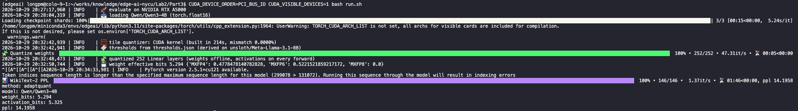

# Part 3: Calibration-Free Quantization Reproduction

| | Paper | Ours |
|---|---|---|
| BF16  | 13.66 | 13.64 |
| MXFP4  | 18.20 | 18.57 |
| NVFP4  | 13.96 | 13.93 |
| **AdaptQuant** | **13.98** | **14.20** |

## 1. Rebuild the environment

```bash
conda create -n adaptquant python=3.11 -y
conda activate adaptquant
```

or

```bash
python3.11 -m venv .venv
source .venv/bin/activate
```

## 2. Install dependencies

```bash
pip install -r requirements.txt
```


```bash
export CUDA_HOME=/usr/local/cuda
export PATH=$CUDA_HOME/bin:$PATH
```

## 3. Run the experiment and evaluate PPL

```bash
bash run.sh
```

```
method: adaptquant
model: Qwen/Qwen3-4B
weight_bits: 5.294
activation_bits: 5.325
ppl: 14.1958
```

To choose a GPU, set it before the command, for example `CUDA_VISIBLE_DEVICES=0 bash run.sh`

Full terminal output of one run on an NVIDIA RTX A5000:



## 4. Reproduce the baselines in the table

```bash
python main.py evaluate --method fp16
python main.py evaluate --method mxfp4
python main.py evaluate --method nvfp4
python main.py evaluate --method adaptquant
```

## Files

| File | Content |
|---|---|
| `main.py` | `evaluate` (quantize Qwen3-4B, report PPL) and `derive` (thresholds) |
| `src/formats.py` | MXFP4 / MXFP6 / MXFP8 element formats, E8M0 block scaling, NVFP4 baseline quantizer |
| `src/tiles.py` | 16 x 32 tiling, the `stat` statistic, per-tile format selection, PyTorch tile quantizer |
| `src/mx_tile_fake_quant.cu` | CUDA kernel: one thread block per tile, one warp per 1 x 32 block |
| `src/cuda_quantizer.py` | builds the CUDA kernel, checks it against PyTorch, falls back to PyTorch if needed |
| `src/thresholds.py` | the threshold table (`thresholds.json`) |
| `src/model_quantizer.py` | quantizes the weights once and the activations on every forward pass (hooks) |
| `src/loading.py` | loads the model and WikiText-2 |
| `src/evaluate.py` | WikiText-2 perplexity for fp16, MXFP4, NVFP4 and AdaptQuant |
| `src/derive.py` | Algorithm 1: per-tile distortion, prefix-sum threshold search on the reference model |
| `thresholds.json` | the 14 threshold pairs derived on the reference model |
| `run.sh` | runs the final experiment |
| `images/logs.png` | terminal output of `bash run.sh` |

## Citation

```bibtex
@misc{anonymous2026adaptquant,
      title={AdaptQuant: Hardware-Aligned Per-Tile MX Format Selection for Post-Training Quantization on NVIDIA Blackwell},
      author={Anonymous},
      year={2026},
      note={Under review as a conference paper at ICLR 2027},
}
```

## Acknowledgements / License

- [AdaptQuant: Hardware-Aligned Per-Tile MX Format Selection for Post-Training Quantization on NVIDIA Blackwell](docs/26502_AdaptQuant_Hardware_Alig.pdf),
  anonymous ICLR 2027 submission. This is an independent reimplementation of its method and Algorithm 1.
- MX element formats and the E8M0 block scale follow the
  [OCP Microscaling Formats (MX) v1.0 specification](https://www.opencompute.org/documents/ocp-microscaling-formats-mx-v1-0-spec-final-pdf).
- Models: [Qwen/Qwen3-4B](https://huggingface.co/Qwen/Qwen3-4B) (Apache 2.0) is the target model, and
  [unsloth/Meta-Llama-3.1-8B](https://huggingface.co/unsloth/Meta-Llama-3.1-8B), a public copy of the gated
  [meta-llama/Llama-3.1-8B](https://huggingface.co/meta-llama/Llama-3.1-8B) (Llama 3.1 Community License)
- Dataset: [WikiText-2](https://huggingface.co/datasets/Salesforce/wikitext) (`wikitext-2-raw-v1`).
